<div align="center">
  
  <h1>Skool Vault</h1>
  <p><b>Download the Skool communities you belong to, and browse them offline</b></p>
  <p>A desktop app for the courses, videos, files, posts and comments you already have access to.<br/>Pick lessons one by one, pause and resume, switch accounts, then open everything in a viewer laid out like Skool.<br/>Your login stays on this PC. No telemetry, no cloud service of its own.</p>

  <a href="https://github.com/DenverCoder1/readme-typing-svg">
    <picture>
      <source media="(prefers-color-scheme: dark)" srcset="https://readme-typing-svg.demolab.com?font=Fira+Code&weight=600&size=16&pause=1000&color=C9D3DC&center=true&vCenter=true&width=600&lines=Courses%2C+Videos+%26+Files+in+Best+Quality;Posts%2C+Comments+%26+Replies;A+Skool-Style+Offline+Viewer;Open+It+on+Your+Phone+with+a+QR+Code;Only+New+%26+Changed+Updates;100%25+Local+%E2%80%A2+No+Telemetry" />
      
    </picture>
  </a>

  <br/><br/>

  <p>
    <a href="../../releases/latest"></a>
    
    
    
    
    
    <a href="LICENSE"></a>
  </p>

  <br/>

  <picture>
    <source media="(prefers-color-scheme: dark)" srcset="docs/screenshots/app-community-dark.png" />
    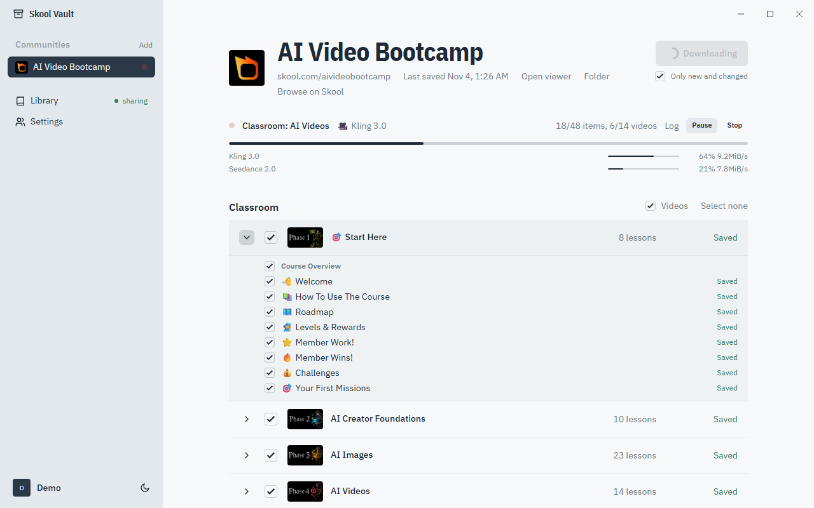
  </picture>

</div>

<br/>

Skool Vault keeps a copy of everything you can see in a Skool community, so it is still there after
your membership ends or the content changes.

- **The classroom**: every course, section and lesson, with lesson text, images, attached files and
  the lesson video in the best quality available, plus subtitles when there are any.
- **The community**: posts, categories, comments and replies, images, attached files, avatars, and
  videos uploaded to posts.
- **Posts inside lessons**: when a creator attaches or links a community post in a lesson, it is
  saved too and shown as a post card, like on Skool.
- **An offline viewer that looks like Skool**, in the app or in any browser.
- **On your phone**: a temporary link and QR code to open your archive from anywhere.
- **Updates that only fetch what changed**: new lessons, new posts and new comments.
- **Light and dark themes** for both the app and the viewer.

> Screenshots use `demo/aivideobootcamp`, a trimmed slice of a real AI Video Bootcamp download. It keeps the
> classroom, covers and posts, with only a few comments on each post. Full videos, attached files, cookies
> and account details are left out.

## Screenshots

**The app.** Two areas: your communities on the left, the selected page on the right. The window has
its own title bar in place of the Windows one.

| | Light | Dark |
|---|---|---|
| **Community** |  | 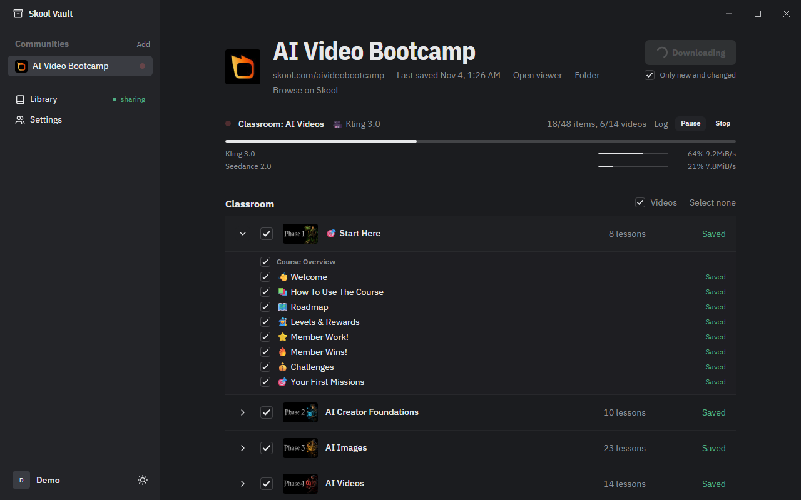 |
| **Library and phone link** | 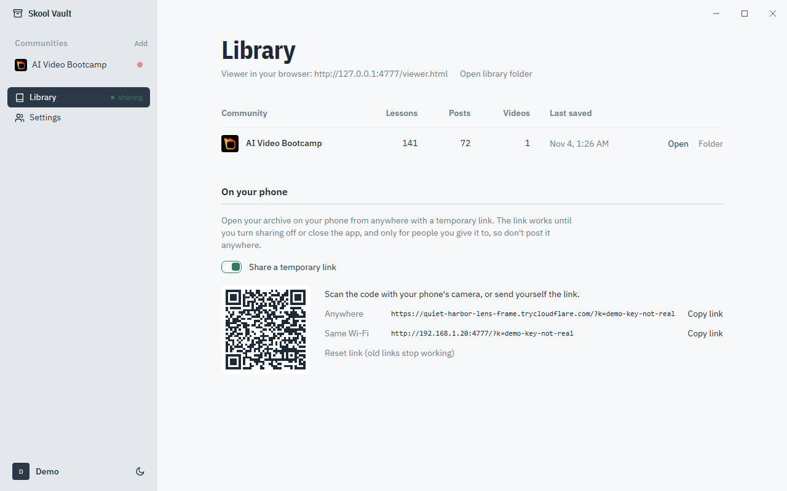 | 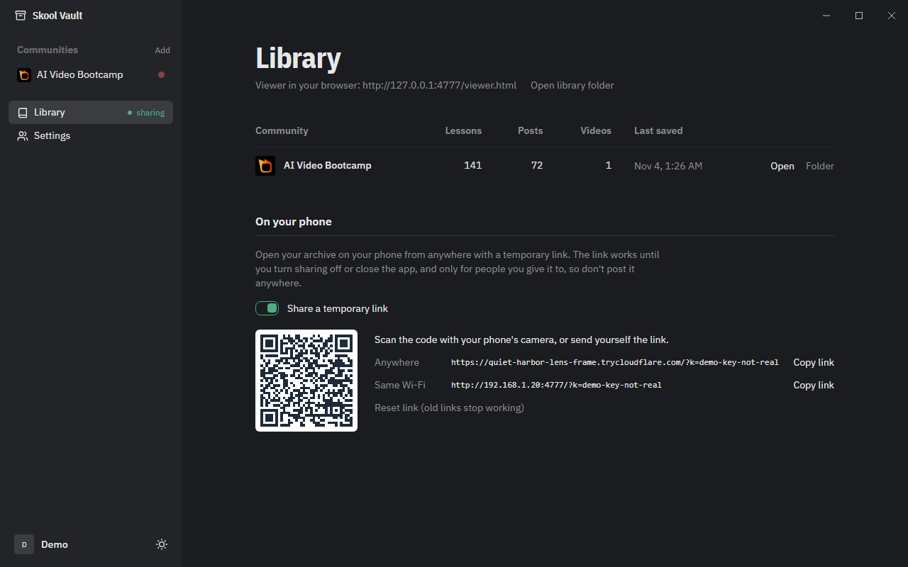 |

**The viewer.** Skool's layout, served from your own PC.

| | Light | Dark |
|---|---|---|
| **Community feed** | 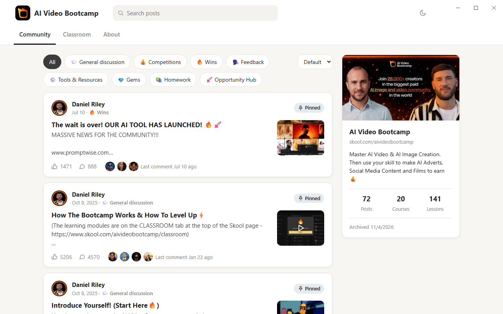 | 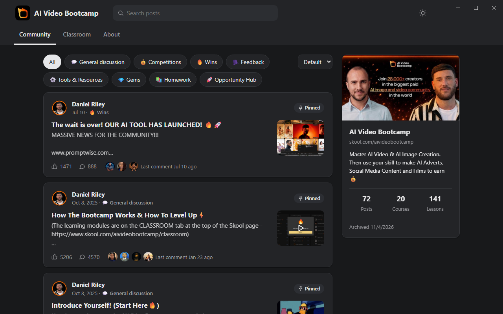 |
| **A post with its comments** | 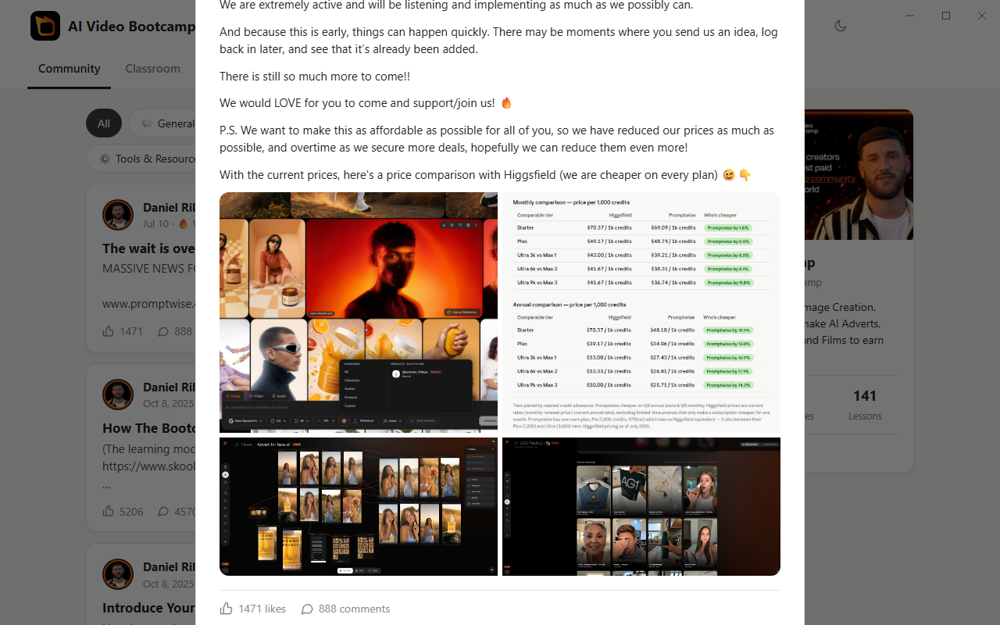 | 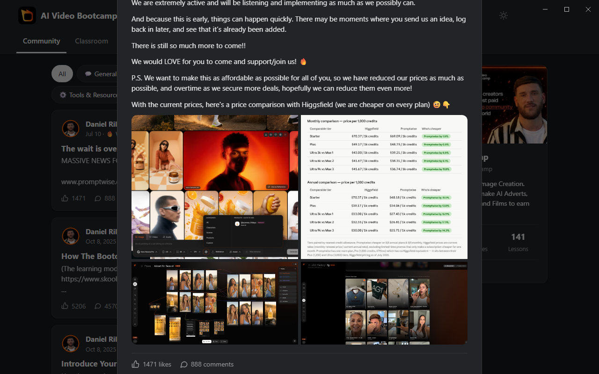 |
| **A lesson** | 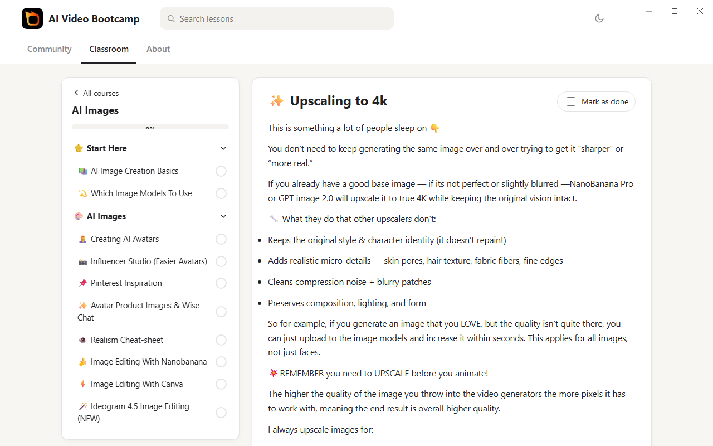 | 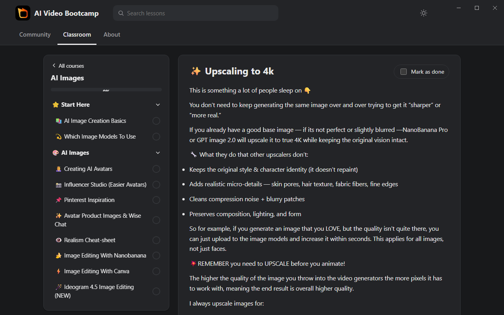 |

| | |
|---|---|
| 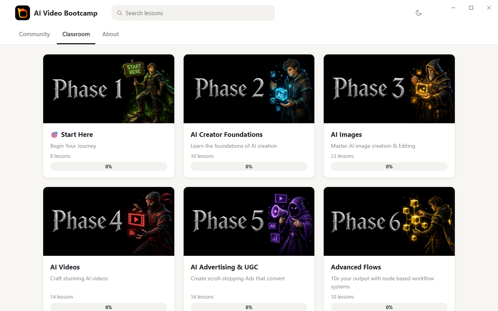 | 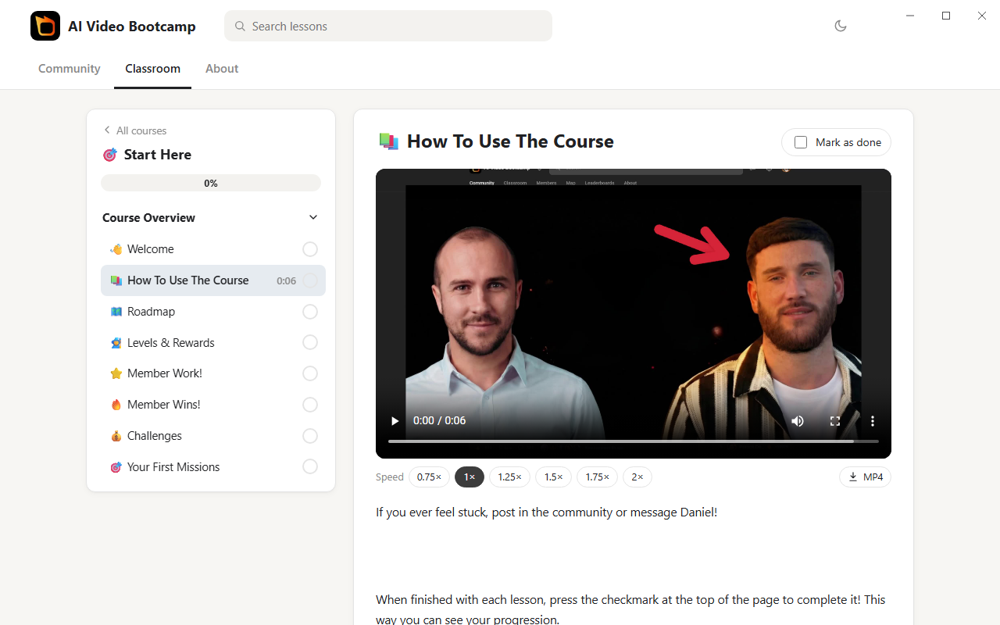 |
| **Classroom**: courses with your progress | **Video lesson**: player with speed control, captions and resume |
| 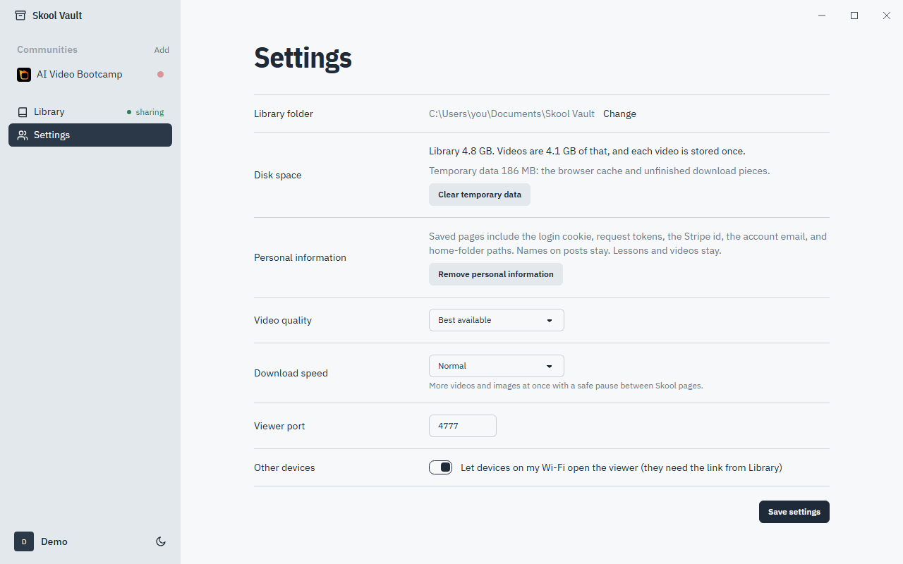 | |
| **Settings**: library folder, quality, speed, viewer | |

## Features

### Downloading

- **Sign in once** in a Skool window inside the app. The session is kept on your PC, and you can log
  out at any time. Several accounts can be saved and switched from the sidebar. Each keeps its own
  session.
- **Your communities** are listed from your Skool account; any other community you're a member of
  can be added by its link.
- **Pick what to save**: courses one by one, or open a course and leave out individual lessons. Also
  the community feed, comments and replies, videos in posts, or only the newest posts.
- **Pause and resume**: hold a download and continue it later. A time-left estimate follows the
  recent pace. Videos already in progress start over when you resume.
- **Videos in the best quality**: Skool-hosted (Mux) streams, YouTube, Loom, Vimeo and Wistia
  through [yt-dlp](https://github.com/yt-dlp/yt-dlp), merged to MP4 with FFmpeg, with English
  subtitles when available. Optional caps at 4K, 1080p or 720p.
- **Every file**: lesson resources and post attachments (PDF, TXT, skill files and so on), saved
  with their original extension.
- **Posts in lessons**: posts a creator pins to a lesson or links from its text are downloaded with
  their comments, attachments and video.
- **Only new and changed**: skips lessons and posts that are already complete. New lessons, new
  posts, posts with new comments and anything that failed last time are still fetched. Files and
  videos already on disk are never downloaded twice.
- **Download speed**: Gentle, Normal or Fast. Videos, images and files download in parallel from
  the CDNs, while Skool pages load one at a time with a pause in between. If Skool pushes back, the
  pause grows by itself and shrinks again once pages load normally.
- **Live progress**: per-video bars, item and video counts, a log, and Stop.

### The viewer

- **Community**: category filters, sort by default, newest or top, search, pinned posts, and post
  cards with the latest commenters and "Last comment" time.
- **Posts**: full text, image galleries, videos, attachments, and threaded comments with replies.
- **Classroom**: course grid with progress, a lesson sidebar with sections, mark as done, previous
  and next.
- **Video player**: playback speed, subtitles, MP4 download, and it remembers where you stopped.
- **Embedded post cards** for posts attached to lessons; clicking one opens the post.
- **Image lightbox** with keyboard navigation, light and dark themes, and a layout that works on
  phones.

### On your phone

- **From anywhere**: one switch opens a temporary `trycloudflare.com` link through a
  [Cloudflare Quick Tunnel](https://developers.cloudflare.com/cloudflare-one/connections/connect-networks/do-more-with-tunnels/trycloudflare/).
  No account and no router setup. The link stops working when you turn sharing off or close the app.
- **On the same Wi-Fi**: an optional local link, no internet needed.
- **A QR code** to scan with your phone's camera, and **Copy link**.
- **Locked by an access key**: other devices need the key in the link the first time, then a
  30-day cookie. Without it they get a "This link is locked" page and none of your archive.
  **Reset link** makes a new key, so every link you shared before stops working.

### The app

- **Two areas**: communities, Library and Settings on the left; the selected page on the right.
- **Custom title bar** with its own minimize, maximize and close buttons, also in viewer windows.
- **Light and dark themes**, following Windows until you pick one.
- **Library**: everything saved, with counts and Open, Browser and Folder buttons.
- **Disk space**: how much the library and temporary files use. Clear the browser cache and
  unfinished download pieces without removing saved videos.
- **Personal information**: remove the login cookie, request tokens, the account email and
  home-folder paths from a saved library. Lessons, posts and videos stay.
- An installer and a portable `.exe`, with the app's own icon and taskbar identity.

## Download

Get the installer or the portable `.exe` from the [latest release](../../releases/latest)
(Windows 10 or 11, 64-bit):

- `Skool-Vault-Setup-<version>.exe` installs with Start-menu and desktop shortcuts.
- `Skool-Vault-<version>-portable.exe` runs without installing.

The builds aren't code-signed, so Windows may show "Windows protected your PC" the first time:
choose **More info**, then **Run anyway**.

## Build

Needs [Node.js](https://nodejs.org) 20 or newer and Python 3 (only for the icon and screenshot
scripts).

```bash
npm install
npm start          # build and run
npm run dev        # run with hot reload
npm run typecheck
npm run dist       # Windows installer + portable exe in release/
```

`npm run dist:mac` and `npm run dist:linux` build for the other platforms.

The Windows installer is made by NSIS, which can't open files more than 260 characters deep. If the
build stops with `could not open file ... .nsh`, build from a shorter folder such as `C:\src`.

## Running

- **First run**: click **Log in to Skool**, sign in, pick a community, choose what to save and press
  **Download**. Later, press **Download new** to fetch only what changed.
- **Open viewer** opens the archive in a window. With the app running it's also at
  `http://127.0.0.1:4777/viewer.html` in any browser on the same PC.
- Downloads go to `Documents\Skool Vault\<community>\` (changeable in Settings). Settings live in
  `%APPDATA%\Skool Vault\settings.json`.
- On first use the app fetches `yt-dlp` and, for phone sharing, `cloudflared` from their official
  GitHub releases into `%APPDATA%\Skool Vault\bin`. yt-dlp updates itself weekly.
- `SKOOL_VAULT_LIBRARY` and `SKOOL_VAULT_PORT` point a run at another library and port without
  touching your settings (handy for testing).
- `npm run demo` rebuilds `demo/aivideobootcamp` from a local archive at
  `Documents\Skool Vault\aivideobootcamp`. With that library running on port 4788,
  `python scripts/screenshots.py` regenerates the screenshots in this README.
- `npm run fixture` writes a separate fictional community to `test-library/` for local checks. It is
  not the community shown above.

## The archive

Each community is a plain folder, readable without the app:

```
<community>/
  group.json          name, description, logo, cover
  classroom.json      courses, sections and lessons (text as HTML, video, resources, attached posts)
  community.json      categories and posts, with comments and replies
  media/              images, avatars, covers, thumbnails
  videos/             one MP4 per lesson (+ .vtt subtitles), and community/ for post videos
  files/              lesson resources and post attachments
  raw/                Skool's own page data, kept so the archive can be re-processed later
  download-log.txt
```

## How it works

**Signing in and reading Skool** (`src/main/skool.ts`). The app opens Skool in a hidden Chromium
window that shares the login session, so Skool's bot protection and sign-in behave like a normal
visit. Course, lesson and post data come from each page's `__NEXT_DATA__`. Calls to Skool's API
(file links, more comments) run inside that logged-in page with Skool's own WAF-aware `fetch`, and
the responses the page receives are read through the DevTools protocol.

**The classroom** (`src/main/scraper.ts`). Each lesson's metadata gives its text (Skool's `[v2]`
rich text or markdown, converted in `richtext.ts`), its video, its resources and any pinned posts.
Files come from `POST /files/:id/download-url`, with clicking the resource on the page as a
fallback.

**Comments**. Skool loads them after the post page opens, 25 top-level comments at a time. The app
keeps the response the page received, then pages with the `first`/`last` cursors exactly as the
site does, converts the API's snake_case fields, and rebuilds the comment and reply tree.

**Videos** (`src/main/media.ts`). Skool-hosted videos are Mux HLS streams served from
`stream.video.skool.com` with a signed token; external videos are page links. yt-dlp picks the
best renditions and FFmpeg merges them to MP4 with `+faststart`. Expired tokens are refreshed by
reopening the page, and the plain Mux host is tried if Skool's is refused.

**The viewer server** (`src/main/server.ts`). A small HTTP server serves the viewer, the archive
JSON and media with HTTP range support for seeking. Requests from this PC are open; anything else
must present the access key.

**Phone sharing** (`src/main/tunnel.ts`) runs `cloudflared tunnel --url` to the viewer's port and
reads the temporary address from its output.

## Project layout

```
src/
  main/              Electron main process
    index.ts         windows, title bar controls, IPC
    accounts.ts      saved Skool logins
    skool.ts         hidden browser session, login, in-page API calls, back-off
    scraper.ts       classroom, community, comments, files, parallel downloads, video queue
    media.ts         yt-dlp and FFmpeg downloads
    vimeo.ts         Vimeo playback
    richtext.ts      Skool rich text and markdown to HTML
    server.ts        viewer and media server, access key
    tunnel.ts        Cloudflare quick tunnel and QR code
    settings.ts      settings and download speed presets
    archive.ts       reading and writing the archive
    strip.ts         remove a login's secrets from a saved library
    temp.ts          cache and unfinished download pieces
  preload/           the bridge between the app's pages and the main process
  renderer/src/
    dashboard/       the app's UI (React, Tailwind, daisyUI)
    viewer/          the Skool-style offline viewer (React)
    common/          title bar window buttons
  shared/types.ts    archive and app data types
scripts/             demo slice, fictional fixture, screenshots, app icon
demo/                trimmed AI Video Bootcamp archive used for the screenshots
build/               app icon (.png, .ico)
docs/                README logo and screenshots
```

## Privacy and fair use

- Your Skool session, settings and downloads stay on your PC. The app talks to Skool, the CDNs
  that host the media, GitHub (to fetch yt-dlp and cloudflared), and Cloudflare only while phone
  sharing is on.
- Archives contain other members' posts and comments. Keep them private, and don't republish
  content you don't own.
- Use it to back up content you have access to. Downloading may conflict with Skool's terms of
  service; you're responsible for how you use it. The Gentle and Normal speeds keep traffic to
  Skool modest.

Not affiliated with or endorsed by Skool. Skool is a trademark of its owner.

## Contributors

- **Claude** ([Claude Code](https://claude.com/claude-code) by Anthropic): design and implementation
  alongside the maintainer.

## Credits and licences

Skool Vault is MIT-licensed; see [LICENSE](LICENSE).

- [Electron](https://www.electronjs.org), [electron-vite](https://electron-vite.org) and
  [electron-builder](https://www.electron.build), MIT.
- [React](https://react.dev), MIT. [Tailwind CSS](https://tailwindcss.com) and
  [daisyUI](https://daisyui.com), MIT.
- [IBM Plex Sans](https://github.com/IBM/plex) via Fontsource, SIL Open Font License 1.1.
- [yt-dlp](https://github.com/yt-dlp/yt-dlp), The Unlicense, downloaded at run time.
- [FFmpeg](https://ffmpeg.org) through [ffmpeg-static](https://github.com/eugeneware/ffmpeg-static);
  the bundled binary is GPL-licensed, see its licence file in the installed app.
- [cloudflared](https://github.com/cloudflare/cloudflared), Apache 2.0, downloaded at run time.
- [node-qrcode](https://github.com/soldair/node-qrcode), MIT.
- Screenshots are taken with [Playwright](https://playwright.dev), Apache 2.0.
